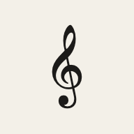
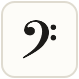
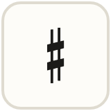
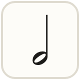
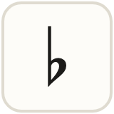
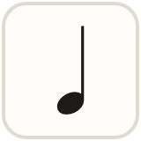

# Musical Sudoku

Sudoku, but music (and a hint of math)

Built on <b>Dancing Links</b>

## How to play

Fill the grid so every **row**, **column** and **box** has each symbol once.

| | Symbol | Note | On the staff | Sound |
| :---: | --- | :---: | :---: | --- |
|  | Eighth note | E | line | two quick notes |
|  | Bass clef | F | space | one beat |
|  | Treble clef | G | line | one beat |
|  | Sharp | A | space | slides up |
|  | Half note | B | line | two beats |
|  | Flat | C | space | slides down |
|  | Quarter note | D | line | one beat |
|  | Fermata | E | space | holds |
|  | Sixteenth note | F | line | four fast notes |

> [!TIP]
> **Note on a line?** Every Good Boy Does Fine: **E G B D F**

> [!TIP]
> **Note in a space?** It spells FACE: **F A C E**

## Levels

| Level | What it's like |
| --- | --- |
| **Learn** | A quick walkthrough, then an arrow explains every move |
| **Easy** | Simple logic. Wrong notes turn red |
| **Medium** | Needs pairs and pointing tricks |
| **Hard** | Advanced logic. No help unless you break a rule |

Grids come in **4×4**, **6×6** and **9×9**.

## Buttons

| | |
| --- | --- |
| **Undo** | Take back your last move |
| **Erase** | Clear a square |
| **Notes** | Pencil in small options |
| **Hint** | Shows the next square and why. Tap again to fill it in |
