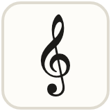
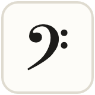
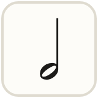
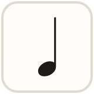
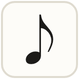
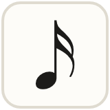
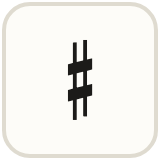
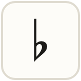
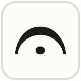

| [🏠 Home](../README.md) | **📖 How to play** | [🧠 Algorithms](algorithms.md) | [💻 Run it](run-it.md) |
| :---: | :---: | :---: | :---: |

# How to play

Fill the grid so every **row**, **column** and **box** has each symbol once.

## The symbols

| | Symbol | Note | Sound |
| :---: | --- | :---: | --- |
|  | Treble clef | G | one beat |
|  | Bass clef | F | one beat |
|  | Half note | B | two beats |
|  | Quarter note | D | one beat |
|  | Eighth note | E | two quick notes |
|  | Sixteenth note | F | four fast notes |
|  | Sharp | A | slides up |
|  | Flat | C | slides down |
|  | Fermata | E | holds |

> [!TIP]
> These are the notes of the treble staff. Lines are **E G B D F** ("every good boy does fine"), spaces are **F A C E**.

## Levels

| Level | What it's like |
| --- | --- |
| **Learn** | A quick walkthrough, then an arrow explains every move |
| **Easy** | Simple logic. Wrong notes turn red |
| **Medium** | Needs pairs and pointing tricks |
| **Hard** | Advanced logic. No help unless you break a rule |

Grids come in **4×4**, **6×6** and **9×9**.

## Buttons

| | |
| --- | --- |
| **Undo** | Take back your last move |
| **Erase** | Clear a square |
| **Notes** | Pencil in small options |
| **Hint** | Shows the next square and why. Tap again to fill it in |
